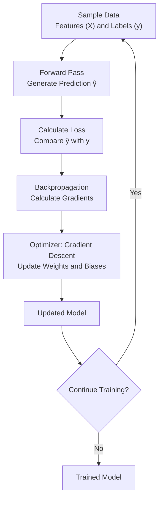
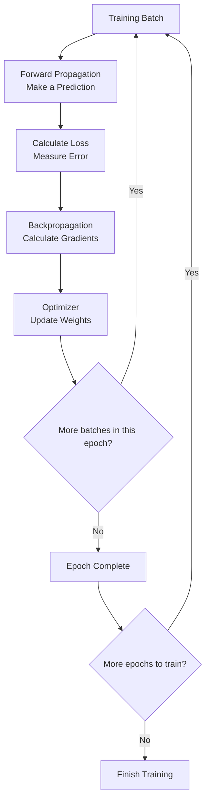
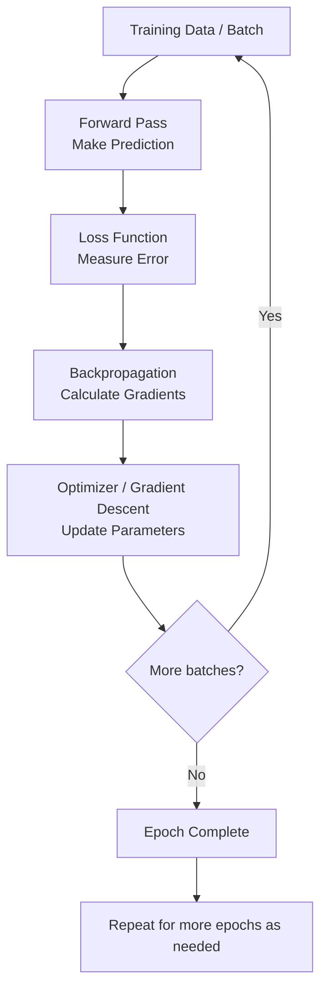

# Artificial Intelligence (AI) By - SAI CHARITH PUTTABAKULA 
This is my class Work for AI by Akshay Saini

---
## 📚 Table of Contents

<!-- START doctoc -->
<!-- END doctoc -->

---

<h1 align="center">SEASON - 1 🔥</h1>

# Episode 1 : The Evolution of AI

> Notes summary from **Namaste AI Notes — Season 1, Episode 02: The Evolution of AI**.

## Overview

This episode traces the development of Artificial Intelligence (AI), from early rule-based systems to Machine Learning, Deep Learning, Transformers, Generative AI, and Agentic AI.

AI is described as the science of making machines perform tasks that normally require human intelligence, such as recommending content, recognizing images, understanding language, and generating text or media.

## 1. History and Key Milestones

| Year / Period | Milestone | Key idea |
|---|---|---|
| 1950 | Alan Turing and the Turing Test | A way to evaluate whether a machine's conversational responses can be distinguished from a human's. |
| 1956 | John McCarthy | The term **Artificial Intelligence** was introduced. |
| 1950s–1980s | Rule-Based AI | Systems used predefined rules and `if/else` conditions to make decisions. |
| 1987–1993 | AI winter (as stated in the notes) | A period when interest and activity in AI declined. |
| 1990s | Machine Learning | Systems increasingly learned patterns from data rather than relying only on manually written rules. |
| 1997 | IBM Deep Blue | Defeated chess champion Garry Kasparov. The notes clarify that Deep Blue relied heavily on search and move evaluation rather than being a modern learning-based AI system. |
| 2000s | Deep Learning | Neural networks became increasingly useful for learning complex patterns. |
| 2012 | AlexNet / ImageNet | A major milestone in deep-learning-based image classification. |
| 2016 | AlphaGo | Defeated Go champion Lee Sedol. |
| 2017 | Transformers | The paper *Attention Is All You Need* introduced the Transformer architecture. |
| November 2022 | ChatGPT | Conversational generative AI became widely accessible to the public. |
| 2025 onward | Agentic AI | Growing focus on AI systems that can use tools and perform multi-step tasks. |

## 2. Rule-Based AI

Early AI systems relied on manually written rules and conditions.

**Example:** An email filter might flag a message as spam when it contains certain words or patterns.

**Limitation:** It is difficult to write rules for every possible situation. Small changes in wording or behavior can cause rule-based systems to fail.

## 3. Machine Learning (ML)

Machine Learning enables systems to learn patterns from examples and use those patterns to make predictions.

**Example:** Train a model using labelled images of cats and dogs, then use it to classify a new image.

Typical workflow:

1. Collect and prepare training data.
2. Train a model to identify patterns.
3. Evaluate its performance.
4. Use the trained model to make predictions on new data.

## 4. Deep Learning (DL)

Deep Learning is a subset of Machine Learning that uses neural networks with multiple layers to learn complex patterns from data.

**Applications mentioned in the notes:**
- Image and face recognition
- Speech recognition
- Computer vision

The notes contrast ML and DL as follows:

| Aspect | Machine Learning | Deep Learning |
|---|---|---|
| Data volume | Often works with smaller datasets | Often benefits from very large datasets |
| Compute | Can require less computational power | Can require substantial compute, often using GPUs |
| Feature engineering | Often requires manually designed features | Can learn useful features during training |
| Training time | Often shorter for simpler models | Can be longer and more resource-intensive |
| Interpretability | Some models are relatively easy to interpret | Complex neural networks can be harder to interpret |

These are general tendencies; actual requirements depend on the model and task.

## 5. Computer Vision

Computer Vision focuses on helping machines interpret visual information.

The notes highlight:
- **ImageNet:** A large image dataset used for visual-recognition research.
- **AlexNet (2012):** A deep neural network that achieved an important image-classification breakthrough.

**Example applications:** Face recognition, driver-assistance and self-driving systems, medical image analysis, and visual product search.

## 6. Natural Language Processing (NLP)

NLP focuses on enabling computers to process and work with human language.

Language is challenging because the same phrase or word can have different meanings depending on context.

**Examples from the notes:**
- “I saw a man with a telescope” — the sentence can have more than one interpretation.
- “River bank” versus “Bank of India” — the word *bank* has different meanings in different contexts.

Techniques and architectures mentioned:
- Bag of Words
- N-grams
- RNNs (Recurrent Neural Networks)
- LSTMs (Long Short-Term Memory networks)

The notes explain that RNNs and LSTMs helped models work with sequential language, while long-range context remained challenging.

## 7. Transformers (2017)

The Transformer architecture was introduced in the research paper **“Attention Is All You Need.”**

Transformers use attention mechanisms to model relationships between tokens and help capture context across a sequence. They became a foundation for many modern language models.

**Why this matters:** Transformers made it practical to build large language models that can process context and generate coherent responses.

## 8. Large Language Models (LLMs)

LLMs are models trained on very large datasets to process and generate language. The notes connect modern LLMs to the Transformer architecture.

Important resource requirements include:
- Large training datasets
- Significant computational power
- GPUs and other specialized hardware

## 9. Generative AI

Generative AI creates new content rather than only classifying, recommending, or predicting.

**Examples:**
- Text and poems
- Software code
- Images
- Audio and video
- Documents and other content

**Multimodal AI** can work with multiple kinds of input or output, such as text, images, audio, and video.

## 10. ChatGPT and Agentic AI

### ChatGPT — November 2022

The notes identify ChatGPT's public release in November 2022 as a major moment in the adoption of conversational AI. They also mention the subsequent growth of other assistants and models.

### Agentic AI — 2025 onward

The episode describes the shift toward AI systems that can do more than respond to a single prompt. Such systems may:
- Plan and reason through steps
- Use tools and APIs
- Search for information
- Write and debug code
- Carry out multi-step workflows with varying degrees of autonomy

The degree of autonomy depends on the system's design, permissions, and safeguards.

## Quick Revision

- **AI:** Machines perform tasks that normally require human intelligence.
- **Rule-Based AI:** Decisions are driven by predefined rules.
- **Machine Learning:** Models learn patterns from data.
- **Deep Learning:** Neural networks learn complex representations.
- **Computer Vision:** Machines process visual information.
- **NLP:** Machines process human language.
- **Transformers:** Attention-based architecture foundational to many modern LLMs.
- **LLMs:** Large models trained to process and generate language.
- **Generative AI:** Creates new content.
- **Agentic AI:** Uses tools and multi-step actions to pursue a goal.

## Main Takeaway

The episode presents AI as an evolving field: from explicit rules, to learning patterns from data, to deep neural networks, to Transformer-based generative models, and increasingly to AI agents that can use tools and complete multi-step tasks.

---

# Episode 2 : Does ChatGPT Know or Does It Guess?

> Summary of the supplied Namaste AI Notes PDF: “Does ChatGPT Know or Does It Guess?”  
> Topics: Google Search vs. LLMs, response generation, knowledge cutoffs, base models, hallucinations, tools, and RAG.

## Overview

This episode explores where ChatGPT gets its answers and whether it retrieves facts or generates responses from learned patterns. It compares traditional search engines with Large Language Models (LLMs) and explains why fluent, confident AI answers can still be incorrect.

## 1. Google Search vs. ChatGPT

### Google Search: Retrieval

According to the notes, Google Search:
1. Takes a user's query.
2. Searches its index of webpages.
3. Ranks relevant pages.
4. Returns links and results that users can inspect.

A **search index** is an organized database of information about webpages. Search engines use crawlers or spiders to discover pages and update the index. Ranking can depend on factors such as relevance, links, page quality, and other signals.

### ChatGPT: Generation

An LLM generates a response based on patterns learned during training and the context available in the conversation. Rather than simply returning a webpage, it creates a new response in natural language.

**Core distinction:** Search primarily retrieves documents; an LLM primarily generates text. Search results can also be misleading or outdated, so neither approach guarantees truth.

## 2. How LLMs Generate Responses

LLMs generate text by predicting likely next tokens based on the preceding context.

**Example:** Given “The sun rises in…”, a model may predict “the east.”

The notes compare this to a sophisticated autocomplete system. Training helps the model learn patterns in language, grammar, facts, associations, and examples. Its output is influenced by probabilities and context; it is not a guarantee that every generated statement is correct.

## 3. What Knowledge Does an LLM Contain?

During training, a neural network adjusts numerical parameters (also called **weights**) to learn patterns from data. The resulting model can use these learned patterns to generate responses.

The notes emphasize that this process involves complex algorithms and that a model's answer is generated from learned patterns and available context.

## 4. Knowledge Cutoff

A model's **knowledge cutoff** is the point up to which its training data or built-in knowledge is generally current. Models are not necessarily retrained every day, and training can be computationally expensive.

A model may still answer questions about recent events when it has access to external tools, such as web search, or when relevant information is supplied in the prompt. The model's built-in knowledge and its access to current information are different things.

## 5. Base Model vs. AI Assistant

A **base model** is trained to predict the next token. On its own, it is not necessarily optimized to follow instructions or behave like a helpful assistant.

An assistant product can add capabilities around a base model, including:
- Instruction tuning and human feedback
- System instructions and conversation management
- Safety rules and content filters
- Tool calling and API access
- Web search or other external information sources

The notes use an analogy: **the base model is the engine, and the assistant is the car**.

## 6. Training vs. Inference

| Concept | Meaning |
|---|---|
| **Training** | The model learns patterns from data by adjusting its parameters. |
| **Inference** | The trained model uses the prompt and available context to produce an output. |

A simple analogy from the notes: training is the learning phase; inference is the working phase when the model answers a question.

## 7. AI Hallucinations and Fake Fluency

An **AI hallucination** occurs when a model generates information that is incorrect or unsupported but presents it as if it were factual.

The notes explain that fluent language and confident wording do not prove that an answer is true. Potential causes include:
- Insufficient or missing knowledge
- Ambiguous prompts or information
- False assumptions
- Unreliable patterns learned during training
- A tendency to produce an answer rather than acknowledge uncertainty

**Important lesson:** Language quality and factual accuracy are separate. Verify important claims, especially in medical, legal, financial, or other high-impact situations.

## 8. How to Reduce Overconfident Answers

The notes recommend asking the model to:
- Provide evidence or sources.
- State uncertainty.
- Answer only when sufficiently confident.
- Use web search or other external evidence when appropriate.

These techniques may help, but they do **not** guarantee correctness. Sources should still be checked directly.

## 9. Tools and Tool Calling

Tools extend an LLM's capabilities beyond the information present in its prompt and learned parameters. Depending on permissions and implementation, tools may include:
- Web search
- APIs and databases
- Email and calendars
- Files and internal documents
- Code execution
- Other connected services

Without the relevant tool and authorization, a model cannot automatically access private files, emails, or databases. Tool access makes an assistant more useful for specific workflows, but actions should be controlled by appropriate permissions and safeguards.

## 10. Retrieval-Augmented Generation (RAG)

**Retrieval-Augmented Generation (RAG)** combines information retrieval with language generation.

A simplified workflow:

1. A user asks a question.
2. A retrieval system searches relevant external sources.
3. Relevant passages or documents are supplied to the LLM.
4. The LLM generates an answer grounded in the retrieved material.

**Why it matters:** Retrieval can provide current or domain-specific evidence that may not be present in the model's training data. The quality of the result still depends on the sources retrieved and how accurately the model uses them.

## 11. What Information Can Influence an LLM Response?

The notes identify four main sources:
1. **Training data** — patterns learned during model training.
2. **Context** — the current conversation and supplied information.
3. **System prompt / instructions** — guidance about how the assistant should behave.
4. **Tools** — external sources or actions available to the assistant.

These components help turn a base model into a more capable assistant. Tool outputs and supplied documents can provide information beyond the model's built-in knowledge.

## Quick Revision

- **Search engine:** Finds and ranks indexed webpages.
- **LLM:** Generates text from learned patterns and current context.
- **Indexing:** Organizes webpage information so it can be searched.
- **Next-token prediction:** A central mechanism used by language models to generate text.
- **Knowledge cutoff:** The limit of the model's built-in training knowledge.
- **Base model:** The core model trained to predict tokens.
- **Training:** Learning patterns from data.
- **Inference:** Generating output with a trained model.
- **Hallucination:** Plausible-sounding but incorrect or unsupported output.
- **Tool calling:** Letting a model use external services or perform permitted actions.
- **RAG:** Retrieval plus generation, helping ground answers in external information.

## Main Takeaway

ChatGPT does not guarantee that it knows or verifies every fact it states. It generates responses from learned patterns and available context. Search, tools, and RAG can provide external evidence, but users should still verify important information rather than treating confidence or fluency as proof.

---

# Episode 3 : The Secret Language of LLMs

> Summary of the supplied Namaste AI Notes PDF: “The Secret Language of LLMs”.

## Overview

This episode explains how Large Language Models (LLMs) process text. Instead of handling text as humans read it, models process tokenized input represented by numerical token IDs. The notes cover tokenization, subwords, vocabularies, Byte Pair Encoding (BPE), multilingual tokenization, tokenization fertility, special tokens, and context windows.

## 1. What Are Tokens?

When text is sent to an LLM, a **tokenizer** breaks it into smaller units called **tokens**. These units may be whole words, parts of words, characters, or other text units, depending on the tokenizer.

For example, the sentence:

`These notes are awesome`

may be split into tokens such as:

`These` · `notes` · `are` · `awesome`

Each token is associated with a numerical **token ID**. The model processes the sequence of token IDs and predicts the next token ID, which is then converted back into text.

**Important:** One word does not necessarily equal one token.

## 2. Tokenizers and Subword Tokenization

A **tokenizer** converts text into tokens according to its vocabulary and tokenization rules. Different models can use different tokenizers, so the same text may be split differently and receive different token IDs.

**Subword tokenization** lets a tokenizer represent less-common or longer words as smaller pieces. For example, the notes show `untrustable` split into pieces such as `un`, `trust`, and `able`.

However, tokenization does not always follow grammar or meaningful word parts. The notes use `undone` as an example of a word that may be represented as one token if it exists in the tokenizer's vocabulary.

Try the tokenizer demonstrations referenced in the PDF:
- [OpenAI Tokenizer](https://platform.openai.com/tokenizer)
- [TikTokenizer](https://tiktokenizer.vercel.app/)

## 3. Vocabulary and Token IDs

A tokenizer's **vocabulary** is the collection of token units it can represent. Each token in that vocabulary maps to a token ID.

Token IDs are identifiers, not definitions of meaning. The model learns patterns from sequences of tokens during training; the numerical ID itself does not directly express the meaning of a word.

The notes mention different tokenization approaches, including:
- Byte Pair Encoding (BPE)
- WordPiece
- Unigram
- SentencePiece-based approaches

Different models and tokenizers may use different vocabularies and algorithms.

## 4. Byte Pair Encoding (BPE)

The notes describe **Byte Pair Encoding (BPE)** as a method that starts from smaller units and merges frequently occurring neighbouring pairs into larger token units.

A simplified explanation:
1. Begin with smaller text or byte-level units.
2. Identify pairs that commonly occur together.
3. Merge selected pairs into new tokens.
4. Build a vocabulary that can represent common patterns efficiently.

This approach allows token pieces to be reused across multiple words instead of requiring every possible word to have its own token.

## 5. English vs. Other Languages

The notes explain that equivalent text in different languages does not necessarily produce the same number of tokens. Tokenization depends on the text and the tokenizer's vocabulary, not simply on whether the meaning is equivalent.

The PDF compares English with Hindi and Hinglish and notes that Hinglish spellings can vary—for example, `main`, `mai`, and `maii`. Such variation can affect tokenization.

In the examples shown in the PDF, English text uses fewer tokens than the corresponding Hinglish text. This is an illustration from the supplied notes, not a rule that applies to every sentence or tokenizer.

## 6. Tokenization Fertility

**Tokenization fertility** is defined in the notes as the average number of tokens produced per word.

- **Lower fertility:** Fewer tokens are used to represent the text, which can reduce token usage and allow more text to fit within a context window.
- **Higher fertility:** More tokens are used, which can increase processing requirements and API cost and consume more of the context window.

The effect depends on the tokenizer, model, language, and text being processed.

## 7. Emojis, Code, Spaces, and Special Characters

The notes explain that emojis, punctuation, capitalization, spaces, and other text patterns can affect tokenization. A visible emoji is not guaranteed to be one token, and changing a space or adding/removing punctuation can change the token sequence and token count.

LLM conversations can also include **special tokens** used to represent message boundaries or other structural information. Their details vary across model families and formats.

## 8. System Instructions vs. User Instructions

- **System instructions:** High-level instructions that guide how an assistant should behave.
- **User instructions:** The task or question supplied by the user.

The notes explain that prompts and instructions are processed as part of the model's input, along with other context. The exact representation depends on the model and its conversation format.

## 9. Context Window

A **context window** is the amount of tokenized information a model can process within a request or active generation context.

It can include:
- System instructions
- The current user prompt
- Relevant conversation messages
- Documents and other supplied text
- Tool outputs
- Text generated by the model

The context window is shared between input and output in the way described by the notes. A larger context window does not guarantee perfect memory or accuracy, and context should not be confused with permanent chat history.

### What happens when context becomes too large?

The notes recommend:
1. Shortening or truncating unnecessary input.
2. Summarizing earlier messages.
3. Asking for the relevant information instead of including everything.
4. Splitting large projects into separate chats or modules.
5. Avoiding the assumption that every old detail will remain available in active context.

## 10. Common Tokenization Misconceptions

The final page of the PDF lists these misconceptions:

- **One token equals one word:** Incorrect.
- **Every model uses the same tokenizer:** Incorrect.
- **A token ID represents meaning:** Incorrect.
- **One visible emoji is always one token:** Incorrect.
- **A larger vocabulary is always better:** Not necessarily.
- **A larger context window means perfect memory:** Not necessarily.
- **More tokens always produce better results:** Incorrect.

The PDF also emphasizes that longer prompts do not automatically produce better answers and that token usage directly affects API costs.

## Quick Revision

| Term | Meaning |
|---|---|
| Token | A unit of text processed by a model |
| Tokenizer | Converts text into tokens |
| Token ID | Numerical identifier assigned to a token |
| Vocabulary | Collection of tokens supported by a tokenizer |
| Subword tokenization | Splitting text into smaller pieces |
| BPE | Tokenization method that merges frequent neighbouring pairs |
| Tokenization fertility | Average number of tokens per word |
| Special tokens | Structural markers used in model input/output formats |
| Context window | Maximum tokenized context the model can process at a time |

## Main Takeaway

LLMs process text through tokenization: text is split into tokens, mapped to token IDs, and processed by the model. Tokenization varies by model and language and affects token counts, cost, and how much information fits into a context window. Understanding these concepts helps when writing prompts and building applications that use LLM APIs.

---

# Episode 4: How Machines Represent Meaning

> Summary of the supplied Namaste AI Notes PDF: “How Machines Represent Meaning” (the source PDF labels it Season 1 — Episode 05).

## Overview

This episode explains how AI models represent words and sentences numerically so they can capture relationships and context. It introduces vectorization, embeddings, semantic similarity, cosine similarity, token embeddings, positional information, text embeddings, and contextualization in Transformer-based language models.

## 1. Token IDs Do Not Contain Meaning

A token ID is a numerical identifier assigned to a token by a tokenizer. The ID itself does not express the token's meaning, and IDs that are numerically close are not necessarily related.

The notes use example IDs for words such as “Dog” and “Grapes” to show that the numbers are identifiers, not semantic descriptions.

## 2. Vectorization

**Vectorization** is the process of converting information—such as words, sentences, documents, or images—into numerical vectors that computers can process mathematically.

The PDF gives a simple fruit example using three dimensions:
- Apple: `[0.7, 0.4, 0.8]`
- Banana: `[0.8, 0.6, 0.2]`
- Carrot: `[0.2, 0.5, 0.9]`

In this illustration, the dimensions represent sweetness, size, and crunchiness. Real embedding dimensions are learned from data and generally do not each have such a simple human-readable meaning.

## 3. Embeddings

An **embedding** is a learned numerical representation of an item, such as a token, word, sentence, or document. Embeddings help models represent relationships between items.

The notes give these illustrative vectors:
- King: `[0.81, 0.32, 0.52]`
- Queen: `[0.79, 0.36, 0.48]`
- Banana: `[0.24, 0.91, 0.11]`

In this example, King and Queen have more similar representations than either has to Banana. Actual modern embeddings often use hundreds or thousands of dimensions.

Embeddings are learned during training; they are not usually assigned manually by a person. Their quality and usefulness depend on the data, model, and training objective.

## 4. Embedding Space and Semantic Clustering

Embeddings can be visualized as points in a geometric space. The PDF provides a two-dimensional illustration with groups such as:
- Fruits: Apple and Banana
- Programming languages: JavaScript and Python
- Human roles: Man and Woman
- Royalty: King and Queen

Related items may appear near one another in an embedding space. However, a 2D or 3D visualization is only a projection of a potentially much higher-dimensional space and can lose information.

**Important:** More dimensions do not automatically mean more intelligence or better results. Larger embeddings can require more storage and computation.

## 5. Semantic Similarity

**Semantic similarity** measures how closely two pieces of text relate in meaning, even when they use different words.

The PDF's example:
- “How do I center a div?”
- “How can I align an HTML element in the middle of its parent?”

The wording differs, but the underlying question is similar. Embeddings can help systems retrieve or compare such semantically related text.

## 6. Cosine Similarity

**Cosine similarity** compares two vectors by measuring the cosine of the angle between them.

- Vectors pointing in similar directions have cosine similarity closer to `1`.
- Orthogonal vectors have cosine similarity around `0`.
- Vectors pointing in opposite directions have cosine similarity closer to `-1`.

This is one way to compare embeddings, but similarity is not the same as truth, correctness, safety, or agreement.

Further reading referenced in the PDF:
- [IBM: Cosine Similarity](https://www.ibm.com/think/topics/cosine-similarity)
- [LearnDataSci: Cosine Similarity](https://www.learndatasci.com/glossary/cosine-similarity/)
- [TensorFlow Embedding Projector](https://projector.tensorflow.org/)

## 7. Similarity Does Not Prove Truth

The notes emphasize that:
- Two false statements can be semantically similar.
- Two harmful instructions can be semantically similar.
- Two texts can discuss the same topic while disagreeing completely.

Embeddings capture learned relationships and relatedness. They do not independently verify facts, intent, quality, or safety.

## 8. Token Embeddings

A **token embedding** maps a token ID to a dense numerical vector. The token ID is an identifier; the embedding is a learned representation used by the model.

As a model processes a sequence, token representations can be updated using surrounding context. The PDF describes token embeddings as useful for the model's internal processing of token sequences.

## 9. Positional Information

Word order affects meaning. Compare:
- “Dog bites Man.”
- “Man bites Dog.”

The same words appear, but the sentence meanings differ because their order differs. Models therefore need information about token positions or sequence order.

The PDF calls this **positional embedding**. More generally, Transformer architectures incorporate positional information through architecture-specific techniques.

## 10. Token Embeddings vs. Text Embeddings

| Type | What it represents | Common uses |
|---|---|---|
| **Token embedding** | An individual token in a sequence | Internal language-model processing |
| **Text embedding** | A sentence, paragraph, or document represented as a vector | Semantic search, retrieval, clustering, recommendation, classification, and duplicate detection |

A text embedding is often designed to summarize information about a larger text unit. Token and text embeddings serve different purposes and should not be treated as interchangeable.

## 11. Polysemy and Contextualization

**Polysemy** means a word can have multiple meanings depending on the sentence.

The PDF's example:
- “Java is a language.”
- “Java is an island in Indonesia.”

The word “Java” appears in both sentences, but its intended meaning differs. In a Transformer-based language model, a token receives an initial embedding and is then processed with surrounding tokens through model layers. Its internal representation becomes **contextualized** according to the sentence.

Context helps the model distinguish meanings that cannot be determined from an isolated word alone.

## 12. Bias and Hybrid Search

The notes point out that biased training data can lead to biased model behavior.

They also mention **hybrid search**, which combines keyword-based search with embedding-based search. Keyword search can match specific terms, while embedding search can find semantically related content. Combining them can improve retrieval for some tasks, including Retrieval-Augmented Generation (RAG).

## 13. Common Embedding Misconceptions

The final page of the PDF highlights these misconceptions:

- **An embedding is a dictionary of tokens:** No; it is a numerical representation that captures learned relationships.
- **Each dimension has one clear human meaning:** Not necessarily; meaning is distributed across many dimensions.
- **Similar embeddings mean identical meaning:** No; similarity can indicate topic, association, category, opposition, or shared context.
- **Embedding similarity proves a statement is true:** No; similarity measures relatedness, not truth.
- **One embedding model works equally well for every task:** No; performance depends on language, domain, data type, text length, and training objective.
- **Visual clusters perfectly represent the original space:** No; low-dimensional projections lose information.
- **A larger embedding dimension is always better:** No; there are trade-offs in storage, latency, cost, and quality.

## Quick Revision

| Term | Meaning |
|---|---|
| Vectorization | Converting information into numerical vectors |
| Embedding | Learned vector representation of an item |
| Semantic similarity | Similarity in meaning, even with different wording |
| Cosine similarity | Vector comparison based on the angle between vectors |
| Token embedding | Vector representation used for an individual token |
| Text embedding | Vector representation of a larger text unit |
| Positional information | Information about token order in a sequence |
| Contextualization | Updating representations based on surrounding context |
| Polysemy | One word having multiple meanings |
| Hybrid search | Combining keyword search and embedding-based search |

## Main Takeaway

Machines represent language and other information using numerical vectors. Embeddings help models capture relationships between words and texts, while positional information and context help distinguish meanings. Similarity is useful for retrieval and comparison, but it does not establish truth or correctness.

---

# Episode 5 : The Computational Brain of Machines

> Summary of the supplied Namaste AI Notes PDF: “The Computational Brain of Machines” (the source PDF labels it Season 1 — Episode 06).

## Overview

This episode explains how a Large Language Model (LLM) generates text using a neural network and the Transformer architecture. It walks through tokenization and embeddings, next-token prediction, attention, layer normalization, causal self-attention, residual connections, feed-forward networks, and the final probability distribution used to select the next token.

## 1. Neural Networks and Next-Token Prediction

The PDF introduces a sentence-completion example: “The pizza is ____.” A model may assign different likelihoods to possible next words, such as “hot,” “ready,” or “delicious.”

The process described in the notes is:
1. A sentence is split into tokens.
2. Tokens are converted into embeddings.
3. The sequence of embeddings is passed into a neural network.
4. The network estimates which token is likely to come next.
5. The predicted token is added to the sequence, and the process repeats.

Generation continues until a stopping condition is reached, such as an end-of-sequence token or another termination rule. The diagram on page 1 illustrates input token IDs and embeddings flowing through a trained neural network to candidate next-token predictions.

## 2. What Does GPT Stand For?

GPT stands for **Generative Pre-trained Transformer**:
- **Generative:** Produces new text rather than simply retrieving a stored answer.
- **Pre-trained:** The model has already learned patterns from training data before being used.
- **Transformer:** The neural-network architecture used to process token sequences.

The notes identify the 2017 research paper **“Attention Is All You Need”** as a major milestone in the development of Transformers. Before Transformers, architectures such as Recurrent Neural Networks (RNNs) and Long Short-Term Memory networks (LSTMs) were widely used for sequence tasks.

## 3. Attention and Self-Attention

**Attention** helps a model weigh different parts of the input when processing a token.

**Self-attention** lets tokens use information from other tokens in the same sequence to build a more context-aware representation.

The PDF's example is: “The cat sat on the mat because it was tired.” The surrounding words help the model interpret what “it” refers to. The illustration on page 3 presents the Transformer and attention as central components of an LLM.

## 4. Token Embeddings and Positional Information

Before a Transformer processes a sentence:
1. Text is converted into tokens.
2. Tokens are mapped to token embeddings.
3. Positional information is incorporated so the model can represent token order.
4. These representations are passed into the Transformer.

Order matters: “Dog bites Man” and “Man bites Dog” use the same words but mean different things. Positional information helps a model account for sequence order.

## 5. Layer Normalization (LayerNorm)

The notes describe **Layer Normalization** as a technique for stabilizing the numerical values flowing through a neural network.

- **Problem:** Activations can become too large or too small as they pass through layers.
- **Purpose:** Normalization helps keep their scale more stable, supporting effective training and computation.

The PDF asks whether normalization causes the model to lose memory, but does not provide an answer. This README therefore does not treat that question as resolved by the source.

## 6. Masked / Causal Self-Attention

In an autoregressive language model, **causal self-attention** prevents a token from attending to future tokens when predicting the next token.

The notes explain:
- **Masked:** Some positions are hidden from the current token.
- **Causal:** Information flows from earlier tokens toward the current position, not from future tokens backward.

This constraint helps ensure the model predicts using only the available preceding context during next-token training and generation.

## 7. Multi-Head Attention

**Multi-head attention** runs multiple attention operations in parallel. Different heads can learn to focus on different relationships or patterns in the input.

The notes describe multi-head causal self-attention as allowing each token to gather information from earlier tokens through multiple attention heads while preventing access to future tokens.

## 8. Residual / Skip Connections

A **residual connection** adds a layer's input to its output rather than discarding the original representation.

The PDF's example:
- Original input: `x = [1, 2, 3]`
- Attention output: `Attention(x) = [0.2, -0.5, 0.7]`
- Residual addition: `x + Attention(x) = [1.2, 1.5, 3.7]`

This lets a layer learn an update to the existing representation. The notes describe the result as preserving useful information while adding the layer's contribution.

## 9. Feed-Forward Network (FFN)

After attention, each token is processed by a **Feed-Forward Network (FFN)**. Unlike self-attention, which mixes information across tokens, the FFN applies transformations to each token representation independently.

The notes summarize the distinction as:

> Attention lets tokens communicate; FFN lets each token process what it learned.

The diagram on page 5 shows an example feed-forward network with input nodes, a hidden layer, and an output node.

## 10. Linear Layer and Softmax

After the Transformer layers, the model produces scores for possible next tokens.

- **Linear layer:** Transforms the hidden representation into scores for candidate tokens.
- **Softmax:** Converts scores into a probability distribution over candidate tokens.

The model then selects or samples a next token according to the generation strategy. The highest-probability token is not always chosen in every configuration; sampling and decoding settings can affect the result.

The PDF compares the linear layer to a mathematical transformation and Softmax to a function that converts raw scores into probabilities that sum to 100%.

## 11. Visual Learning Resources

The PDF recommends these resources for exploring the architecture:
- [LLM Visualization by Brendan Bycroft](https://bbycroft.net/llm)
- [Andrej Karpathy's nanoGPT repository](https://github.com/karpathy/nanoGPT)
- Research paper: **Attention Is All You Need** (referenced in the source PDF)

The visualization is suggested as a way to follow the processing steps and inspect how information moves through an LLM.

## Quick Revision

| Term | Meaning |
|---|---|
| Neural network | A trainable computational model that transforms numerical inputs |
| Next-token prediction | Estimating a likely next token from preceding context |
| GPT | Generative Pre-trained Transformer |
| Transformer | Neural-network architecture for processing sequences using attention |
| Self-attention | Lets tokens use information from other tokens in a sequence |
| Positional information | Represents the order of tokens |
| LayerNorm | Normalizes activations to help stabilize computation |
| Causal mask | Prevents access to future tokens during autoregressive prediction |
| Multi-head attention | Multiple attention operations performed in parallel |
| Residual connection | Adds a layer's input to its output |
| FFN | Processes each token representation independently after attention |
| Linear layer | Maps hidden representations to vocabulary scores |
| Softmax | Converts scores into a probability distribution |

## Main Takeaway

An LLM generates text through repeated next-token prediction. Token embeddings and positional information enter Transformer layers, where attention builds context, normalization helps stabilize activations, residual connections preserve and update representations, and feed-forward networks transform each token. A final linear layer and Softmax produce scores and probabilities for possible next tokens.

---

# Episode 6: Sharpening the Brain

> Summary of the supplied Namaste AI Notes PDF: “Sharpening the Brain” (the source PDF labels it Season 1 — Episode 07).

## Overview

This episode explains how neural networks learn during training. It covers model parameters, training data, forward passes, loss functions, backpropagation, gradients, gradient descent, optimization methods, self-supervised learning, training terminology, generalization, overfitting, and distributed training.

## 1. Training vs. Inference

The notes distinguish two stages:

- **Training:** The model learns patterns by adjusting its parameters using training data and feedback from a loss function.
- **Inference:** The trained model is used to produce predictions or responses for new inputs.

Training repeatedly predicts and updates the model. Inference uses the learned parameters to generate an output. The notes emphasize that training typically consumes more computational resources and costs more than inference.

## 2. What Does Learning Mean in a Neural Network?

A neural network contains many adjustable numerical values called **parameters**. During training, these values are updated so that the model performs better on its objective.

The PDF compares an untrained network to a newborn and a trained network to someone who has practiced a skill. An untrained or poorly trained model may make random or incorrect predictions.

## 3. Parameters, Weights, and Biases

**Parameters** are learned numerical values inside a model. They include:
- **Weights:** Values that control the influence of inputs on calculations.
- **Biases:** Adjustable offsets that help shift a neuron's activation.

The notes compare parameters to knobs and dials that are adjusted as the model learns. Patterns and relationships from training are represented across these parameters; they are not stored as a human-like list of facts or memories.

The PDF gives GPT-3 as an example with 175 billion parameters. It also makes a broad claim about later GPT models; model-specific parameter counts are not established by the notes here.

## 4. Training Data

**Training data** is the collection of examples used to train a model. The notes compare it to textbooks, flashcards, and practice problems. Parameters belong to the model, while training data supplies examples from which the model learns patterns.

## 5. Forward Pass

A **forward pass** is the process in which input data travels through the network to produce a prediction.

The PDF uses the prompt `The sky is ____`:
1. The input is converted into numerical representations.
2. The representations pass through the network using its current parameters.
3. The model produces scores or probabilities for possible next tokens.
4. It may predict `blue` if the model has learned the relevant pattern.

The notes illustrate an incorrectly trained model predicting `banana` instead of `blue`. This example motivates the need to measure prediction error.

## 6. Loss Function

A **loss function** assigns a numerical value to how far a prediction is from the target.

- Correct or suitable prediction: lower loss.
- Very wrong prediction: higher loss.

Training aims to reduce the loss over many examples and updates. In the PDF's example, predicting `banana` when the target is `blue` should incur a higher loss than predicting `blue`.

## 7. Backpropagation (Backward Pass)

**Backpropagation** calculates how the loss changes with respect to the model's parameters. It propagates information about the error backward through the network and computes gradients.

The notes' example:
1. The model predicts `banana` for `The sky is ____`.
2. The loss indicates that the prediction is wrong.
3. Backpropagation calculates how parameters contributed to the error.
4. An optimization algorithm uses the gradients to update the parameters.

**Key distinction:** Backpropagation calculates gradients; it does not, by itself, perform the parameter update.

## 8. Gradients and Gradient Descent

A **gradient** indicates how changing a parameter affects the loss and the direction in which the loss increases most rapidly.

**Gradient descent** is an optimization algorithm that updates parameters in the direction opposite to the gradient to reduce the loss. The notes compare it to walking down a foggy mountain by taking steps toward lower ground.

The PDF identifies three core ideas:
- Loss function: measures prediction error.
- Gradient: provides the direction and sensitivity information.
- Learning rate: controls the size of each update.

Training repeats prediction, loss calculation, gradient calculation, and parameter updates over many examples.

## 9. Types of Gradient Descent

### Batch Gradient Descent
Uses the entire dataset to calculate the update.
- **Advantage:** A stable update based on all examples.
- **Trade-off:** Can be slow and memory-intensive.

### Stochastic Gradient Descent (SGD)
Updates parameters using one example at a time.
- **Advantage:** Frequent updates and low memory use per example.
- **Trade-off:** Updates can be noisy and fluctuate.

### Mini-Batch Gradient Descent
Uses small groups of examples for each update.
- **Advantage:** Balances computational efficiency with less noisy updates.
- The PDF describes mini-batch training as common in modern AI training.

## 10. Self-Supervised Learning

**Self-supervised learning** uses patterns within raw data to create training signals, rather than requiring a human to label every example manually.

The notes describe a language-model example: the model learns by predicting missing or upcoming text, such as the next word in a sentence. Repeating this task over large datasets helps the model learn statistical patterns and relationships in language.

## 11. Important Training Terminology

| Term | Meaning |
|---|---|
| Dataset | The collection of training examples |
| Batch | A group of examples processed together |
| Training step | One optimization update |
| Epoch | One complete pass through the training dataset |
| Forward pass | Computes a prediction from the input |
| Loss | Numerical measure of prediction error |
| Backpropagation | Calculates gradients of the loss |
| Gradient | Sensitivity information used to guide parameter updates |
| Learning rate | Controls the size of parameter updates |
| Inference | Using a trained model to make predictions |

A batch is not the same as an epoch: an epoch covers the full dataset, often through many batches and training steps.

## 12. Generalization

**Generalization** is a model's ability to perform well on examples it did not directly encounter during training.

The notes use the sky example: a model should not merely memorize that the sky is blue on sunny days; it should be able to handle a new example where the sky is gray during a storm.

Good training aims to learn patterns that remain useful beyond the exact examples in the training data.

## 13. Overfitting

**Overfitting** occurs when a model fits its training examples too closely but performs poorly on new data.

The PDF illustrates this with a model trained only on sunny-sky examples. If it memorizes the rule that the sky is always blue, it may fail on a stormy scene.

Overfitting is the opposite of the generalization goal: memorizing the training examples is not enough if the model cannot handle unseen cases.

## 14. Distributed Training

**Distributed training** divides the work of training a large model across multiple computers or accelerators. These machines work in parallel and exchange information needed for training.

The notes explain that large training workloads require substantial computation and memory, making distributed systems and GPUs important for large-scale model training.

## 15. Training Loop at a Glance

```text
Training examples
       ↓
   Forward pass
       ↓
    Prediction
       ↓
  Calculate loss
       ↓
  Backpropagation
       ↓
 Calculate gradients
       ↓
 Optimizer updates parameters
       ↓
 Repeat over batches and epochs
```

This loop is repeated across training data so that the model can reduce its loss and improve its predictions.

## Quick Revision

- **Parameters:** Learned weights and biases inside the model.
- **Training data:** Examples used to learn patterns.
- **Forward pass:** Produces a prediction.
- **Loss function:** Measures how wrong the prediction is.
- **Backpropagation:** Calculates gradients.
- **Gradient descent:** Uses gradients to update parameters in order to reduce loss.
- **Self-supervised learning:** Creates learning signals from the data itself.
- **Epoch:** One pass through the full training dataset.
- **Generalization:** Performing well on unseen examples.
- **Overfitting:** Performing well on training data but poorly on new data.
- **Distributed training:** Spreading training computation across multiple machines or accelerators.

## Questions for Self-Review

The source PDF ends with questions for further study:
1. What are parameters?
2. How do embeddings learn?
3. How do parameters change?
4. What happens during a forward pass?
5. What exactly does backpropagation do?
6. How does gradient descent work?
7. How does an LLM learn from data?
8. How does a model generalize?
9. Why does overfitting happen?
10. Does a machine really understand, or just predict?

## Main Takeaway

Training improves a neural network by repeatedly making predictions, measuring errors, calculating gradients through backpropagation, and updating parameters with an optimizer. Self-supervised learning enables models to learn from large amounts of unlabeled data. The goal is not simply to memorize training examples, but to generalize to new inputs.

---

# Episode 7 : How AI Models Become Assistants — From Pre-Training to Post-Training

> Summary of the supplied Namaste AI Notes PDF: “How AI Models Become Assistants: From Pre-Training to Post-Training” (the source PDF labels it Season 1 — Episode 08).

## Overview

This episode explains how a next-token-predicting base model is shaped into a helpful conversational assistant. It covers three broad stages—pre-training, training, and post-training—and focuses on data collection and cleaning, supervised fine-tuning, instruction tuning, human preference feedback, reward models, reinforcement learning from human feedback (RLHF), and common alignment challenges.

## 1. The Three Main Stages

The PDF outlines three stages in creating an assistant:

1. **Pre-training:** Collect and refine large amounts of data.
2. **Training:** Train the neural network on the prepared data to produce a base model.
3. **Post-training:** Shape the base model to follow instructions and behave more like a useful assistant.

The diagram on page 1 presents this overall journey from pre-training through fine-tuning and alignment to a public-facing assistant.

## 2. Pre-Training: Collecting and Cleaning Data

### Common Crawl

The notes describe **Common Crawl** as a free, publicly accessible repository of web-crawl data. Automated crawlers discover pages by following links and collect web content. The PDF presents it as one possible source of large-scale text for language-model training.

Raw HTML can contain navigation menus and other irrelevant material, so the notes emphasize refining pages to retain useful training content. Different organizations may use their own crawlers and data-filtering pipelines.

### FineWeb and FineWeb-Edu

- **FineWeb:** The PDF describes this as Common Crawl data processed by Hugging Face into a cleaner dataset for LLM pre-training. It highlights filtering for URLs, text quality, repetition, spam, and other low-quality content.
- **FineWeb-Edu:** A more specialized version that prioritizes educationally valuable text, such as explanations, tutorials, and academic material.

The diagram on page 3 shows a data-processing pipeline with stages such as URL filtering, text extraction, language filtering, quality filtering, deduplication, and other filters.

**Why filtering matters:** The notes stress that private, unwanted, or low-quality material should not be blindly included in training data. Building a high-quality dataset is itself a major engineering and research task.

## 3. Training and the Base Model

During the training stage, the model learns from the cleaned data using the neural-network processes discussed in earlier episodes: tokenization, Transformer layers, forward passes, loss calculation, backpropagation, and parameter updates.

The result is a **base model**—a model that has learned broad patterns from its training data but is not necessarily optimized to act as a conversational assistant.

The notes compare a base model to a student who has learned a great deal but has not yet received specialized training for a particular job. It may continue text in plausible ways without consistently following a user's request or producing the desired answer format.

## 4. Post-Training: Shaping Assistant Behaviour

Post-training adapts the base model so it can respond to instructions, use appropriate tone and structure, and behave in ways that are more helpful and suitable for users.

The notes' central distinction is:

> **Training builds capabilities. Post-training shapes behaviour.**

Post-training does not simply mean repeating the entire pre-training process. It uses more targeted examples and preference signals to influence how existing capabilities are expressed.

## 5. Supervised Fine-Tuning (SFT)

**Supervised Fine-Tuning (SFT)** continues training an already pre-trained model on a smaller, targeted dataset containing examples of desired responses.

The PDF describes examples formatted like conversations between a user and an assistant. The model learns from examples of questions and appropriate answers, making it more likely to respond in a useful assistant-like way.

The underlying learning loop remains the familiar one: input → prediction → loss calculation → backward pass → parameter update.

## 6. Instruction Tuning

**Instruction tuning** is a form of fine-tuning focused on following instructions. It helps the model respond to requests such as:
- Explain a concept.
- Summarize or rewrite text.
- Classify information.
- Write a poem.
- Generate code or structured output such as JSON.

The notes explain that instruction tuning helps move a model beyond merely continuing a text sequence toward performing the task requested by the user.

Different fine-tuning data and training choices can lead models to respond differently in style, format, or areas of strength.

## 7. Conversation Formatting: System, User, and Assistant

The PDF introduces three message roles used to structure model conversations:

- **System:** Background rules or instructions that guide the model's behaviour.
- **User:** The human's question, command, or task.
- **Assistant:** The model's response.

These roles help separate operating instructions from the user's request and the assistant's reply. Page 5 illustrates the three roles, while page 6 explains their purpose and gives examples.

## 8. Why SFT May Not Be Enough

Even after SFT, a model may answer the question but not match the user's preferences. For example, it might give an overly long answer when a concise explanation would be better.

The notes point out that people may prefer different levels of detail, tones, and formats. Human feedback can help identify which of several candidate responses is more useful or appropriate.

## 9. Evaluation Gap

The **evaluation gap** describes the difficulty of evaluating generated content, especially when there is no single objectively correct answer.

The notes contrast generating content with judging it: people may find it easier to choose the better of several jokes or answers than to create the best one from scratch. Human evaluation can be valuable, but it is slow and expensive, so researchers may combine human reviews with automated metrics.

## 10. Reward Models

A **reward model** is trained using human feedback or preference comparisons to estimate how desirable a response is according to the patterns in that feedback.

The notes describe a process in which reviewers compare candidate answers, select the preferred response, and provide comparison data. A reward model learns from these preferences and assigns scores to responses.

The PDF also notes an important limitation: a reward model is not human judgment itself. It is a learned approximation based on a limited set of judgments.

## 11. Reinforcement Learning and RLHF

**Reinforcement learning (RL)** is described as learning through actions and feedback in the form of rewards or penalties.

**Reinforcement Learning from Human Feedback (RLHF)** uses human judgments of model responses to guide further optimization. The PDF presents a simplified three-step example:

1. The model produces alternative answers.
2. Human reviewers compare or rank the answers.
3. The preference signal is used to encourage outputs more like the preferred responses.

Over time, this process can encourage responses that better match human preferences for helpfulness, safety, and style.

## 12. Limitations and Risks in Preference Optimization

### Human disagreement

People do not always agree. Some prefer short answers, others prefer detailed answers, and reviewers can make mistakes. Human evaluation is also expensive and cannot cover every possible response.

### Lossy simulation of human preferences

A single score compresses a complex judgment into a simple number. That score may fail to capture *why* a response was preferred or which aspects were good or bad. The notes call this a lossy simulation of human preferences.

### Reward hacking

**Reward hacking** occurs when a model finds a way to obtain a high reward score without actually achieving the intended goal. The PDF compares this to a student who optimizes a grading metric without learning the material.

### Goodhart's Law and reward over-optimization

The notes summarize **Goodhart's Law** as: when a measure becomes a target, it can stop being a good measure.

Increasing a reward score may improve usefulness initially, but optimizing the score too aggressively can lead to shortcuts that raise the metric while reducing actual quality. Therefore, a higher reward score does not automatically mean a response is more helpful.

The notes also emphasize that being helpful does not mean always agreeing with the user; sometimes the better response is to correct a mistaken assumption.

## 13. Knowledge vs. Behaviour

The PDF distinguishes a model's underlying capabilities from the way it presents them:

- **Training builds capabilities:** It develops broad patterns and skills from data.
- **Post-training shapes behaviour:** It influences how those skills are expressed in response to instructions.

For example, post-training may help a model present knowledge of JavaScript closures clearly when asked, rather than simply introducing all-new knowledge about closures.

## 14. The Complete Pipeline

The overall journey summarized in the PDF is:

```text
Common Crawl / Other Data Sources
              ↓
      Filtering and Cleaning
              ↓
          Clean Dataset
              ↓
      Pre-Training / Training
              ↓
          Base Model
              ↓
  Supervised Fine-Tuning (SFT)
              ↓
        Instruction Tuning
              ↓
     Human Preference Feedback
              ↓
          Reward Model
              ↓
              RLHF
              ↓
       Post-Trained Assistant
```

The PDF notes that additional product-level elements—such as system instructions, safety guardrails, tools, web search, memory, retrieval-augmented generation (RAG), and product logic—may be added around or after post-training.

## Quick Revision

| Term | Meaning |
|---|---|
| Common Crawl | Public web-crawl data repository |
| FineWeb | Cleaned web-text dataset described in the notes |
| FineWeb-Edu | FineWeb variant focused on educational content |
| Base model | Pre-trained model not yet fully shaped into an assistant |
| Post-training | Targeted training that shapes assistant behaviour |
| SFT | Fine-tuning on examples of desired responses |
| Instruction tuning | Fine-tuning focused on following user instructions |
| System role | Background instructions and behavioural rules |
| User role | The user's request or input |
| Assistant role | The model's response |
| Evaluation gap | Difficulty of accurately evaluating generated content |
| Reward model | Model that scores responses based on learned preferences |
| RL | Learning guided by rewards and penalties |
| RLHF | Optimization guided by human feedback |
| Reward hacking | Maximizing a score without meeting the real objective |
| Goodhart's Law | A metric can become less useful when optimized as a target |
| General principle | Training builds capabilities; post-training shapes behaviour |

## Interview and Revision Questions

The source PDF ends with questions including:
1. What is the difference between a base model and a chat assistant?
2. What is pre-training?
3. Why is data cleaning and filtering important?
4. What are Common Crawl and FineWeb?
5. What happens during training?
6. Why is post-training required?
7. What are SFT and instruction tuning?
8. What are the system, user, and assistant roles?
9. Why might SFT not be enough?
10. What is the evaluation gap?
11. What is a reward model, and how does it learn from preferences?
12. What are reinforcement learning and RLHF?
13. What are the limitations of human feedback?
14. What are lossy simulation of preferences, reward hacking, and Goodhart's Law?
15. What is the difference between knowledge and behaviour?
16. Explain the complete journey from raw web data to an AI assistant.

## Main Takeaway

A public-facing AI assistant is not created by pre-training alone. Large-scale data is collected and filtered, a base model is trained, and post-training methods such as SFT, instruction tuning, and preference optimization shape how it responds. Human feedback can improve usefulness, but it is imperfect and can be gamed by over-optimizing a reward metric.

---

# Episode 8: Can AI Really Think?

> Summary of the supplied Namaste AI Notes PDF: “Can AI Really Think?” (the source PDF labels it Season 1 — Episode 09).

## Overview

This episode explores whether AI models can reason, how reasoning-oriented generation differs from direct generation, and why some tasks benefit from additional computation during inference. It introduces reasoning models, Chain of Thought, reinforcement learning with human feedback, verifiable rewards, evaluator types, Tree of Thoughts, Graph of Thoughts, and the limitations of reasoning systems.

## 1. Can AI Really Think?

The notes begin with the question of whether newer AI models can reason or “think.” Models can explain technical topics, write about scientific subjects, and perform arithmetic, but they can still fail on complicated questions.

The episode uses a thoughtful gift recommendation as an example: a useful answer may require considering a person's preferences, history, and needs rather than generating an immediate suggestion.

The central question is whether AI can make thoughtful decisions instead of simply producing a direct response based on learned patterns.

## 2. Reasoning-Oriented Generation

**Reasoning-oriented generation** means working through a problem step by step before producing an answer. Rather than immediately generating a likely response, the model can break a complex task into smaller parts, consider alternatives, and check its work.

The notes suggest this approach can help with:
- Mathematics and logic puzzles
- Coding and debugging
- Research tasks
- Complex decision-making

### Example: Revenue increase and decrease

If revenue increases by 20% and then decreases by 20%, the changes do not cancel out:

1. Start with 100.
2. A 20% increase gives 120.
3. A 20% decrease from 120 gives 96.
4. The final value is 96% of the original, a **4% decrease**.

The key lesson is that a step-by-step calculation can avoid an intuitive but incorrect answer.

## 3. Reasoning Models

A **reasoning model** allocates more computation during inference to work through complex problems before answering. The notes contrast direct generation—where a fast response may be sufficient—with reasoning-oriented generation, which can involve planning, checking edge cases, testing, debugging, and revising.

The PDF mentions DeepSeek R1 as an example of a reasoning model. It also refers to AlphaGo as an earlier example of reinforcement learning being used to master complex tasks.

The episode emphasizes that more computation during training is not the only factor that matters; useful computation while answering can also affect performance.

## 4. Chain of Thought

**Chain of Thought (CoT)** refers in the notes to intermediate reasoning steps used to work toward an answer. It is presented as a technique or terminology associated with solving complex tasks step by step.

The PDF uses a classic bat-and-ball question:

> A bat and a ball cost ₹110 together. The bat costs ₹100 more than the ball. How much does the ball cost?

Let the ball cost \(x\) rupees. The bat then costs \(x + 100\).

\[
x + (x + 100) = 110
\]

\[
2x = 10 \quad \Rightarrow \quad x = 5
\]

So the ball costs **₹5**, and the bat costs ₹105.

## 5. More Thinking Is Not Always Better

The notes state that additional reasoning can improve the chance of getting a correct answer, but it does not guarantee correctness. More computation can have diminishing returns; excessive reasoning can even lead a model away from an initially correct solution.

**Key takeaway:** The amount of reasoning should be appropriate to the task. A simple request may not need lengthy reasoning, while a difficult coding or mathematical problem may benefit from additional computation.

## 6. Reinforcement from Verifiable Feedback/Reward (RLVF/RLVR)

The PDF describes **Reinforcement from Verifiable Feedback/Reward (RLVF/RLVR)** as an approach in which a model learns from tasks with objectively checkable outcomes.

Instead of relying solely on a human reviewer, a program or set of rules can evaluate the result and provide a reward when it is correct.

Examples given in the notes include:
- Arithmetic questions with definite answers
- Chess outcomes
- Coding tasks that can be checked with tests

The notes contrast this with subjective tasks, such as creating a travel itinerary, where human preferences may be needed.

The distinction is:

- **Subjective preference → Human evaluation → RLHF**
- **Verifiable answer → Program or rules-based evaluation → RLVF/RLVR**

## 7. Types of Evaluators

The PDF identifies three types of evaluators:

1. **Deterministic evaluator:** Checks an answer using an exact answer, compiler, unit tests, or schema validator. This is useful when correctness can be checked precisely.
2. **Human evaluator:** A person reviews the answer when judgment, context, or expertise is needed.
3. **Model evaluator (LLM-as-a-Judge):** Another language model assesses the output.

### Limitations of LLM-as-a-Judge

The notes mention potential biases and reliability problems. For example, **position bias** occurs when the order or position of candidate answers influences the model's judgment. Model-based evaluation can be useful, but it has limitations and should not automatically be treated as definitive.

## 8. Tree of Thoughts (ToT)

**Tree of Thoughts** is described as a problem-solving approach that explores multiple reasoning paths. The model can evaluate different possibilities and backtrack when a path does not work, rather than following just one straight line.

## 9. Graph of Thoughts (GoT)

**Graph of Thoughts** represents reasoning as interconnected ideas, or nodes and links. The approach can combine or revisit ideas instead of restricting the process to a single linear path.

The PDF notes that visible reasoning is not necessarily a faithful representation of a model's actual internal process.

## 10. Limitations of Reasoning Models

According to the notes, reasoning models can still:
- Hallucinate or produce false information
- Make arithmetic errors
- Misunderstand the question
- Make incorrect assumptions
- Spend too much computation without improving the answer

More thinking does not guarantee correctness. The PDF summarizes effective AI problem-solving as involving three important factors:

**Knowledge + Reasoning + Tools**

## Quick Revision

| Term | Meaning |
|---|---|
| Reasoning-oriented generation | Working through a problem in steps before answering |
| Reasoning model | A model that uses additional inference computation for complex problems |
| Chain of Thought (CoT) | Intermediate reasoning steps used to work toward an answer |
| RLHF | Reinforcement learning guided by human feedback |
| RLVF/RLVR | Learning guided by verifiable outcomes or rewards |
| Deterministic evaluator | Uses exact checks, tests, compilers, or validators |
| Human evaluator | Uses human judgment or expertise |
| LLM-as-a-Judge | Uses another language model to evaluate an answer |
| Position bias | Evaluation influenced by the position/order of candidate answers |
| Tree of Thoughts | Explores multiple reasoning paths and can backtrack |
| Graph of Thoughts | Connects and combines ideas in a graph-like structure |
| Overthinking | Additional reasoning that yields diminishing returns or worsens a result |

## Interview and Revision Questions

The source PDF ends with questions such as:
1. Can a reasoning model still hallucinate?
2. Does more thinking always produce a better answer?
3. How does reasoning-oriented generation differ from direct generation?
4. What is Chain of Thought?
5. Why might a reasoning model use more computation during inference?
6. What is a reward model, and why is it needed?
7. How do RLHF and RLVR differ?
8. Why can some answers be evaluated automatically while others need human judgment?
9. What is LLM-as-a-Judge, and what biases can affect it?
10. What is the relationship between reward hacking, Goodhart's Law, and reward over-optimization?
11. Can AI make a thoughtful decision without simply agreeing with the user?
12. Does AI reasoning mean it thinks like a human?
13. Can additional reasoning ever make an answer worse?

## Main Takeaway

Reasoning-oriented AI uses additional computation to work through complex tasks rather than immediately generating a response. Verifiable feedback can help improve performance on tasks with objectively checkable answers, while subjective tasks may need human evaluation. Reasoning models remain fallible: additional computation can help, but it does not guarantee truth or correctness.

---
<div align="center">

# Neural Network Learning Cycle

### Forward Propagation · Loss Calculation · Backpropagation · Gradient Descent

*A visual guide to how neural networks learn from prediction errors and update their parameters.*

</div>

---

## 📌 Overview

A neural network learns through a repeated training cycle: it makes a prediction, measures how far that prediction is from the correct answer, calculates gradients, and updates its parameters to reduce the loss.

<div align="center">

**Training Data** → **Forward Pass** → **Loss** → **Backpropagation** → **Optimizer Update** → **Repeat**

</div>

## 🔄 The Training Flowchart



## 1. 📥 Sample Data

The model receives training examples containing **input features** and the correct output, also called the **label**.

### Example: House-price prediction

| Item | Value |
|---|---:|
| Area | 1,000 sq. ft. |
| Bedrooms | 2 |
| Actual house price (label, \(y\)) | ₹50 lakh |

- **Features (\(X\))**: area and number of bedrooms.
- **Label (\(y\))**: the actual house price, ₹50 lakh.

The model uses the features to predict the price.

## 2. ➡️ Forward Pass (Forward Propagation)

The input moves through the network layer by layer. The network uses its current weights, biases, and activation functions to produce a prediction.

**Example**

- Actual price: ₹50 lakh
- Model prediction: ₹40 lakh

The prediction can be represented as:

\[
\hat{y}=f(X;W,b)
\]

Where:

- \(X\) = input features
- \(W\) = weights
- \(b\) = biases
- \(\hat{y}\) = predicted output

> **Key point:** Forward propagation produces a prediction. It does not itself update the model's weights.

## 3. 📉 Calculate Loss

A **loss function** measures the difference between the model's prediction and the actual output.

For this example:

- Actual price = ₹50 lakh
- Predicted price = ₹40 lakh
- Difference = ₹10 lakh

For a regression problem, we could use **Mean Squared Error (MSE)**. Using values in lakh rupees:

\[
L=(y-\hat{y})^2
\]

\[
L=(50-40)^2=100
\]

A smaller loss generally means a better fit to the training example.

> **Key point:** The loss measures how wrong a prediction is. It does not, by itself, determine how each weight should change.

## 4. 🔁 Backpropagation

**Backpropagation** calculates gradients of the loss with respect to the model's trainable parameters. It propagates the error signal backward through the network, from the output toward earlier layers.

For example, the gradient of the loss with respect to a weight is:

\[
\frac{\partial L}{\partial W}
\]

This gradient indicates how the loss changes when that weight changes slightly. The calculation uses the chain rule of calculus.

> **Key point:** Backpropagation calculates gradients. The optimizer uses those gradients to update the parameters.

## 5. ⚙️ Optimizer — Gradient Descent

**Gradient Descent** updates the model's weights in a direction intended to reduce the loss.

A common update rule is:

\[
W_{\text{new}}=W_{\text{old}}-\eta\frac{\partial L}{\partial W}
\]

Where:

- \(W_{\text{old}}\) = current weight
- \(\eta\) = learning rate
- \(\frac{\partial L}{\partial W}\) = gradient of the loss with respect to the weight

The minus sign indicates movement opposite to the gradient, which locally points toward increasing loss.

### Why the learning rate matters

- **Too small:** Training may progress very slowly.
- **Too large:** Training can become unstable or fail to converge.
- **Appropriate:** Updates can make steady progress toward a lower loss.

Other optimizers include **SGD with momentum, RMSProp, and Adam**.

## 6. ✅ Updated Model

After the optimizer updates the weights and biases, the model can make another prediction. The cycle repeats over batches of training data and multiple epochs.

The aim is to learn patterns that generalize to new, unseen examples. A lower training loss does **not** guarantee better performance on unseen data, so evaluation on separate data is important.

## 🧠 Quick Comparison

| Stage | Main purpose |
|---|---|
| **Forward propagation** | Computes a prediction |
| **Loss function** | Measures prediction error |
| **Backpropagation** | Calculates gradients |
| **Gradient Descent / optimizer** | Updates weights using gradients |
| **Updated model** | Makes the next prediction with revised parameters |

## 🔁 Remember the Sequence

<div align="center">

### Data → Prediction → Error → Gradients → Weight Updates → Improved Predictions

</div>

Training repeats this process many times. The flowchart represents the main steps of one training iteration; real training usually involves many batches and epochs, and can use optimizers beyond plain Gradient Descent.

## 🎯 Quick Self-Test

1. What is the difference between a feature and a label?
2. Does forward propagation update the weights?
3. What does a loss function measure?
4. What does backpropagation calculate?
5. Which component updates the weights?
6. How can an excessively high learning rate affect training?
7. Does lower training loss always mean better performance on unseen data?

---

<div align="center">

**Core takeaway:** The model predicts, measures error, calculates gradients, and updates its parameters—then repeats.

</div>

---

<div align="center">

# Understanding Epochs in Machine Learning

### Epoch · Batch · Iteration · Model Training

*A concise guide to how training data is processed and how neural networks improve their predictions.*

</div>

---

## 📌 What Is an Epoch?

In Machine Learning and Deep Learning, an **epoch** is one complete pass through the entire training dataset during model training.

For example, if a neural network is trained using **1,000 cat and dog images**, one epoch is completed after the model has processed all 1,000 images once.

## 🐱🐶 Simple Example

| Epoch | What happens? |
|---|---|
| **Epoch 1** | The model processes all 1,000 images once. |
| **Epoch 2** | The model processes the full dataset again, generally using updated weights. |
| **Epoch 10** | The model has completed 10 passes through the dataset. |

The model learns through repeated training, adjusting its parameters as it processes examples.

## 🔍 Epoch vs. Batch vs. Iteration

These three terms describe different parts of the training process.

| Term | Meaning | Example |
|---|---|---|
| **Epoch** | One complete pass through the training dataset | All 1,000 images processed |
| **Batch** | A subset of the dataset processed together | 100 images |
| **Iteration** | One training step, commonly one optimizer update using a batch | Process one batch and update weights |

### Calculation example

Suppose you have:

- **Training samples:** 1,000
- **Batch size:** 100
- **Number of epochs:** 5

**Batches per epoch**

\[
\frac{1000}{100}=10
\]

Assuming one optimizer update per batch, that gives **10 iterations per epoch**.

**Total iterations for 5 epochs**

\[
10 \times 5 = 50
\]

So, under these assumptions, training for 5 epochs involves **50 iterations**.

> **Note:** If the dataset size is not evenly divisible by the batch size, the number of batches depends on whether the final partial batch is kept or dropped.

## ⚙️ How Does an Epoch Help a Model Learn?

A typical training loop follows these steps:



1. **Forward propagation:** The model makes predictions from the input data.
2. **Loss calculation:** A loss function measures the difference between predictions and the correct answers.
3. **Backpropagation:** The model calculates gradients that indicate how the parameters affect the loss.
4. **Optimizer update:** The optimizer uses those gradients to update the weights and biases.
5. **Repeat:** The process continues across batches until the training dataset has been processed, completing one epoch.

Training can then continue for additional epochs.

## 📈 Does More Epochs Mean a Better Model?

Not always. The number of epochs affects how long the model trains, but additional training does not guarantee better performance.

- **Too few epochs — underfitting:** The model may not learn the patterns in the data sufficiently.
- **Too many epochs — possible overfitting:** The model may fit the training examples too closely and perform poorly on unseen data.

Use validation data to monitor performance and help decide when to stop training.

## 🧠 Quick Revision

- **Epoch:** One complete pass through the entire training dataset.
- **Batch:** A subset of training examples processed together.
- **Iteration:** One training step, commonly one parameter update.
- **Batch size:** The number of examples in a batch.
- **Underfitting:** The model has not learned the training patterns sufficiently.
- **Overfitting:** The model fits training data too closely and generalizes poorly.

### Interview-Ready Definition

> An epoch is one complete pass of the entire training dataset through a machine learning model during training.

---

<div align="center">

**Remember:** Epoch = one full pass · Batch = a subset · Iteration = one training step

</div>

---
<div align="center">

# Sharpening the Brain
### Neural Network Training, Learning & Generalization

</div>

---

## 📌 Overview

This episode explains how neural networks learn from training data. A model makes predictions, measures its errors with a loss function, calculates gradients through backpropagation, and updates its parameters using an optimization algorithm.

It also introduces self-supervised learning, epochs and batches, the difference between training and inference, **generalization**, overfitting, and distributed training.

## 🧠 1. What Does Learning Mean in a Neural Network?

A neural network learns by adjusting its internal numerical values—called **parameters**—to improve predictions for a particular objective.

The notes compare parameters to adjustable knobs: at the start, their values may produce poor predictions; during training, the model updates them based on errors.

### Parameters: weights and biases

- **Weights** determine how strongly inputs influence calculations.
- **Biases** provide adjustable offsets in those calculations.
- Together, these learned values influence the model's output.

Parameters encode patterns and relationships learned from training data. They are not a human-like database of facts or memories.

## 📚 2. Training Data

**Training data** is the collection of examples used to train a model. The notes compare it to textbooks and practice problems.

The model uses these examples to learn patterns that can help it make predictions on later inputs.

## ➡️ 3. Forward Pass

A **forward pass** is the process in which input data travels through a neural network to produce a prediction.

The episode uses the prompt:

> “The sky is ____”

The model processes the input and predicts a likely next word. If it assigns a high probability to “banana” instead of a sensible completion such as “blue,” it may not have learned the relevant pattern well.

## 📉 4. Loss Function

A **loss function** measures how far a prediction is from the target answer.

- A prediction that matches the target typically receives a lower loss.
- A poor prediction typically receives a higher loss.

Training aims to reduce the loss across examples. The loss provides a numerical measure of prediction error, but parameter updates require gradient calculations and an optimizer.

## 🔁 5. Backpropagation

**Backpropagation** calculates how the loss changes with respect to the model's parameters. It propagates gradient information backward through the network using the chain rule.

This tells the optimizer how the weights and biases affect the loss.

> **Remember:** Backpropagation calculates gradients; the optimizer uses those gradients to update parameters.

## ⚙️ 6. Gradient Descent and Optimization

**Gradient Descent** is an iterative optimization algorithm that updates parameters in the direction intended to reduce the loss.

The notes compare it to walking down a foggy mountain: use the slope to choose a downward step, then repeat.

Its key components are:

- **Loss function:** Measures prediction error.
- **Gradient:** Indicates how the loss changes as parameters change.
- **Learning rate:** Controls the size of each update.

### Types of Gradient Descent

| Method | How it works | Trade-off described in the notes |
|---|---|---|
| **Batch Gradient Descent** | Uses the entire dataset for an update | Stable, but can be slow and memory-intensive |
| **Stochastic Gradient Descent (SGD)** | Updates using one example at a time | Frequent, low-memory updates, but can be noisy |
| **Mini-Batch Gradient Descent** | Updates using small groups of examples | Balances efficiency and update stability; widely used in modern training |

## 🔄 7. The Training Loop

The main learning cycle is:



This process repeats across training batches and epochs so the model can improve its predictions.

## 🌱 8. Self-Supervised Learning

**Self-supervised learning** uses patterns within raw data to create learning signals, without requiring a human to label every example.

For example, a language model can learn by predicting a missing or upcoming part of a sentence. Repeating this task over large amounts of text helps it learn statistical patterns in language.

## 📖 9. Dataset, Batch, Step, and Epoch

| Term | Meaning |
|---|---|
| **Dataset** | The collection of training examples |
| **Batch** | A group of examples processed together |
| **Training step / iteration** | One optimization update |
| **Epoch** | One complete pass through the training dataset |

An epoch is not the same as a batch: one epoch generally contains multiple batches.

## 🔄 10. Training vs. Inference

| Training | Inference |
|---|---|
| The model learns from examples and updates its parameters. | The trained model uses its learned parameters to produce predictions for input data. |
| Involves loss calculation, gradients, and optimization. | Usually runs the forward computation to produce outputs. |
| Can require substantial computation and cost. | Typically does not update model parameters during ordinary prediction. |

The notes emphasize that training usually consumes more computational power and costs more than inference.

## 🎯 11. What Is Generalization?

**Generalization** is a model's ability to perform well on examples it did not directly memorize or encounter during training.

A model should learn useful patterns rather than simply repeat its training examples.

### Example: Understanding the sky

Imagine a model is trained on images of sunny days and learns to associate the sky with blue. If it later sees an unseen image of a stormy day and correctly predicts that the sky is gray, it has applied a learned concept to a new situation.

Good generalization means learning patterns that remain useful beyond the exact training examples.

## ⚠️ 12. Overfitting

**Overfitting** occurs when a model performs very well on training data but poorly on new, unseen examples.

For example, if a model only memorizes that the sky is blue in its sunny-day training images, it may incorrectly predict blue for a stormy night.

| Generalization | Overfitting |
|---|---|
| Learns patterns that remain useful for unseen data. | Fits training examples too closely and struggles with new data. |
| Supports useful predictions beyond the training set. | Often reflects memorization rather than robust pattern learning. |

The goal is not simply to minimize training error, but to build a model that also performs well on unseen data.

## 🖥️ 13. Distributed Training

**Distributed training** splits the work of training a large model across multiple computers or accelerators. These devices work in parallel and exchange information needed for training.

The notes explain that very large datasets and models may exceed the time or memory capacity of a single machine. Distributed systems help scale the workload.

## 📝 Quick Revision

- **Parameters:** Learned numerical values, including weights and biases.
- **Training data:** Examples used to teach the model patterns.
- **Forward pass:** Produces a prediction.
- **Loss function:** Measures prediction error.
- **Backpropagation:** Calculates gradients of the loss.
- **Gradient Descent:** Uses gradients to update parameters.
- **Self-supervised learning:** Learns from signals derived from the data itself.
- **Epoch:** One full pass through the training dataset.
- **Inference:** Uses a trained model to make predictions.
- **Generalization:** Performs well on unseen examples.
- **Overfitting:** Performs well on training data but poorly on new data.
- **Distributed training:** Shares training computation across multiple machines or accelerators.

## 🎓 Questions for Self-Review

1. What are neural-network parameters?
2. How do embeddings learn?
3. How do parameters change during training?
4. What happens during a forward pass?
5. What does backpropagation calculate?
6. How does Gradient Descent work?
7. How does an LLM learn from data?
8. What is the difference between training and inference?
9. What is an epoch, and how does it differ from a batch?
10. What is generalization?
11. Why does overfitting happen?
12. Does a machine really understand, or does it predict?

---

<div align="center">

**Core takeaway:** Training repeatedly predicts, measures error, calculates gradients, and updates parameters. The goal is to learn patterns that generalize—not merely memorize training examples.

</div>
---
